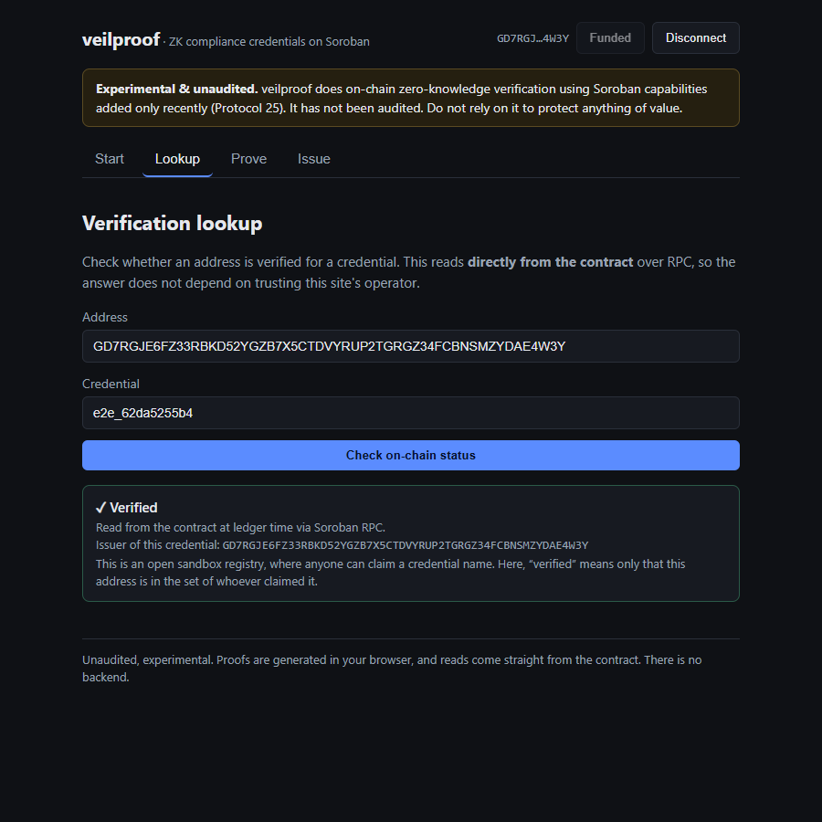
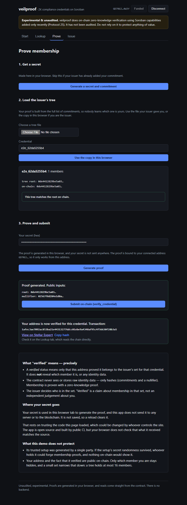

# veilproof-web

The web dashboard for **veilproof**, the Soroban zero-knowledge
compliance-credential suite.

**Live demo: <https://veilproof.github.io/veilproof-web/>**, on Stellar testnet. With a
testnet wallet you can run the whole flow alone in a few minutes: the Start tab walks
through it.

- **Issuers** build a credential tree and publish its root on-chain.
- **Holders** generate a membership proof in their browser and submit it on-chain to
  become _verified_ for a credential, without revealing which member they are.
- **Anyone** can look up whether an address is verified for a credential, read
  **directly from the contract**.

The app has no backend. It is static files served by GitHub Pages, and it runs the
same circuit as [veilproof-server][server], compiled to WebAssembly, against
[veilproof-registry][registry] on-chain.

> **Experimental & unaudited.** veilproof does on-chain ZK verification using
> Soroban capabilities added only recently (Protocol 25). It has not been
> audited. Don't rely on it to protect anything of value.



## The privacy & trust model, precisely

This is the part that matters, and the UI states it plainly rather than
implying more:

- **A "verified" status reveals only membership.** It means the address proved
  it belongs to the issuer's set for that credential. It does **not** reveal
  _which_ member, or any identity data.
- **The contract never sees raw identity data** — only hashes (leaf commitments
  and a nullifier). Membership is proven with a Groth16 zero-knowledge proof.
- **Your secret stays in your browser tab.** The proof is generated there, in
  WebAssembly, and the app does not send the secret to any server or to the
  chain, or save it. `npm run e2e` records every request the page makes and fails
  if the secret appears in one.
- **That rests on the code the page loaded.** Whoever controls the site could
  serve different code. It is open source and built by public CI, but your browser
  doesn't check that what it received matches the source.
- **The issuer defines the set.** "Verified" is a claim about membership in the
  issuer's set, not an independent judgement about a person.
- **The demo registry is an open sandbox.** Anyone can claim a free credential
  name there, so "verified" means only that an address is in the set of whoever
  claimed it. The Lookup tab says so and shows the issuer.
- **The trusted setup is single-party.** If its secret randomness survived, whoever
  holds it could forge proofs, and nothing on-chain would show it.
- **The set is small.** A tree holds 16 members, so hiding which one you are hides
  you among at most 15 others. The tree file shows its size to anyone holding it.

The proof is also **bound to the holder's address**, so a proof seen in transit
can't be replayed by someone else.



## Independent on-chain reads

The verification lookup reads `is_verified` straight from the veilproof-registry
contract over Soroban RPC (`src/chain/reads.ts`). So the answer to "is this address
verified?" comes from the chain, and you can check it against any RPC node.

## How it works without a backend

- **Proving** runs [`prover/`][prover] from veilproof-server as WebAssembly in a
  worker (`src/prover`). The module and the keys are static files, fetched at build
  time and checked against the SHA-256 pins in `prover.lock.json`. The keys are public:
  in Groth16 only the setup's toxic waste has to stay secret.
- **Trees** are a list of commitments kept in the issuer's browser and shared as a
  small JSON file (`src/tree`). A holder computes their own witness from the whole
  list, so nobody learns which leaf is theirs.
- **Everything else** is the contract: publishing, verifying, and reading status.

## Deployment

Pushing to `main` deploys to GitHub Pages (`.github/workflows/pages.yml`), which needs
no account beyond the repository and has no plan to expire. To host it elsewhere,
`npm run build` and serve `dist`, on any static host. Set `VEILPROOF_BASE` when
serving from a subpath.

What can still go away is the contract: **testnet is reset from time to time, which
removes every contract on it.** `.github/workflows/e2e.yml` runs weekly to notice. To
recover, rerun the deploy in veilproof-registry, which takes a minute and no paid
account, and put the new contract id in `.env.production`. Trees and statuses from
before a reset are gone with it.

## Tech

- **TypeScript + React 19 + Vite 8**, Vitest for tests.
- **`@stellar/stellar-sdk` 17** for on-chain reads and building/submitting the
  contract invocations.
- **`@creit.tech/stellar-wallets-kit` 2.6** for wallet connection (Varial, formerly Freighter,
  xBull, and others through one interface).

## Quickstart

```sh
npm install
npm run dev                    # http://localhost:5173
```

That runs against the public testnet registry. Then follow the Start tab.

## Configuration

All config is public (no secrets), read from `VEILPROOF_*` env vars at build
time. `.env.production` holds the testnet deployment; see `.env.example` to override
it.

| Variable                         | Meaning                                                   |
| -------------------------------- | --------------------------------------------------------- |
| `VEILPROOF_REGISTRY_CONTRACT_ID` | deployed veilproof-registry contract id (`C…`)            |
| `VEILPROOF_RPC_URL`              | Soroban RPC endpoint                                      |
| `VEILPROOF_NETWORK_PASSPHRASE`   | network the contract is on                                |
| `VEILPROOF_VK_SHA256`            | expected verifying key digest; the prover refuses others  |
| `VEILPROOF_CIRCUIT`              | circuit a self-service credential binds to (`membership`) |

## Layout

```
src/config.ts     public config from env
src/prover/       the WebAssembly prover, in a worker
src/tree/         credential trees: the file format and the copy in this browser
src/chain/        reads.ts (direct on-chain reads), submit.ts (wallet-signed writes), wallet.ts,
                  errors.ts (contract errors in plain language), network.ts (names and explorers)
src/components/   TrustNotice (the honest privacy copy), WalletBar, RootStatus, TxLink
src/pages/        Start, Lookup, Holder (Prove), Issuer
scripts/          fetches the prover and keys, checked against prover.lock.json
tests/            Vitest — the real prover, tree files, pages, and guards on the trust copy
e2e/              the whole flow in a real browser against testnet, wallet aside
```

## Screenshots

- `docs/screenshots/lookup.png` — the verification lookup (direct on-chain read).
- `docs/screenshots/prove.png` — the holder flow with the full trust notice.

## Scripts

```sh
npm run dev       # dev server
npm run build     # type-check + production build
npm test          # Vitest
npm run lint      # eslint + prettier --check
npm run format    # prettier --write
npm run e2e       # the whole flow in Chrome against testnet, spending only test XLM
```

## License

Apache-2.0 — see [LICENSE](LICENSE).

[server]: https://github.com/veilproof/veilproof-server
[registry]: https://github.com/veilproof/veilproof-registry
[prover]: https://github.com/veilproof/veilproof-server/tree/main/prover
